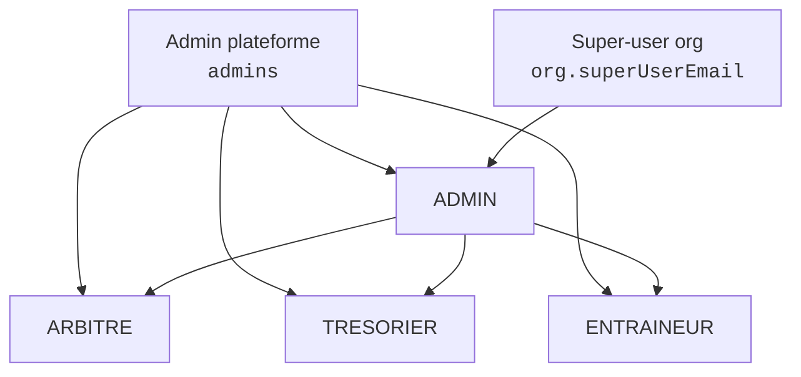

# Droits d’accès — tuiles Admin

Référence des rôles qui affichent chaque tuile du hub `/admin`.

Source : `platform/admin.mustache` + `AdminApi.page()`.

## Rôles

| Code | Signification |
|------|----------------|
| `ADMIN` | Administrateur (club / organisation) |
| `ARBITRE` | Gestion des événements (création, édition, inscriptions, guichet…) |
| `TRESORIER` | Trésorier (paiements, licences) |
| `ENTRAINEUR` | Entraîneur (adhésions) |
| Admin plateforme | E-mail listé dans `admins` (`params.properties`) |
| Super-user org | `org.superUserEmail` de l’organisation courante → traité comme `ADMIN` |

Règles importantes :

- Un `ADMIN` satisfait **tous** les rôles (`RoleCode.satisfies`).
- Le hub `/admin` est visible dès qu’un utilisateur a **au moins un** rôle (`canSeeAdminMenu`).
- Certaines sections dépendent aussi des fonctionnalités activées (événements, adhésions, paiements).

## Héritage des droits

Flèche = « implique / satisfait aussi ».

Résumé :

- **Admin plateforme** → tous les rôles.
- **Super-user org** → `ADMIN` (sur l’organisation courante uniquement).
- **`ADMIN`** → tous les rôles applicatifs.
- `ARBITRE`, `TRESORIER` et `ENTRAINEUR` n’héritent d’aucun autre rôle.

## Événement

Section affichée si (événements **ou** paiements actifs) **et** (`ARBITRE` **ou** `ADMIN` **ou** `TRESORIER`).

| Tuile | Chemin | Droit | Feature requise |
|-------|--------|-------|-----------------|
| Tous les événements | `/admin/events` | `ARBITRE` | Événements |
| Inscriptions joueurs | `/playersubscription-admin` | `ARBITRE` | Événements |
| Paiements | `/payment` | `TRESORIER` | Paiements |
| Tableau de bord | `/dashboard` | `ARBITRE` | Événements |
| Statistiques | `/statistics` | `TRESORIER` **ou** `ARBITRE` | Événements **ou** paiements |

## Utilisateurs

Section affichée si `ARBITRE` **ou** `ADMIN`.

| Tuile | Chemin | Droit |
|-------|--------|-------|
| Joueurs | `/customplayer` | `ARBITRE` |
| Joueurs Lucene manuels | `/database/manual-players` | `ADMIN` |
| Base de données | `/database` | `ADMIN` |
| Utilisateurs connectés | `/logged-users` | `ADMIN` |
| Autorisations | `/user-authorization` | `ADMIN` |
| Connexion en tant que | `/logas` | `ADMIN` |

## Adhésion

Section affichée si adhésions actives **et** (`TRESORIER` **ou** `ENTRAINEUR` — donc aussi `ADMIN`).

| Tuile | Chemin | Droit |
|-------|--------|-------|
| Adhésions | `/membership` | `TRESORIER` **ou** `ENTRAINEUR` |
| Options d'adhésion | `/membership-option-admin` | `TRESORIER` **ou** `ENTRAINEUR` |
| Fichiers d'options | `/membership-option-files` | `TRESORIER` **ou** `ENTRAINEUR` |
| Licences | `/license-admin` | `TRESORIER` |

## Système

Section affichée si `ADMIN`.

| Tuile | Chemin | Droit |
|-------|--------|-------|
| Organisations | `/admin/organisations` | Admin plateforme uniquement |
| Modifier l'organisation | `/admin/organisations/{id}` | `ADMIN` (organisation courante résolue) |
| Plateforme | `/admin/org` | Admin plateforme uniquement |
| Vider le cache | `/admin/clear-cache` | `ADMIN` |
| Email admin | `/admin/mail` | `ADMIN` |
| Saisons | `/admin/seasons` | `ADMIN` |

Notes :

- **Organisations** (liste / création multi-tenant) et **Plateforme** (SSO/OAuth, base de données, JWT) sont réservées à l’admin plateforme.
- **Modifier l'organisation** (identité, factures, fichiers, paiements du club) est accessible à un `ADMIN` de l’organisation courante, ou à l’admin plateforme.
